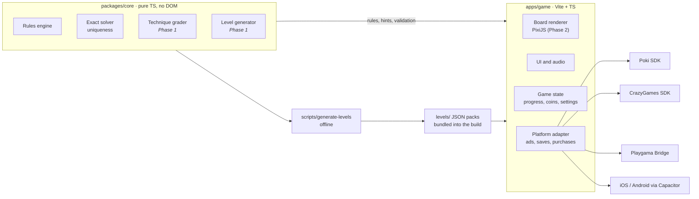

# Architecture

One codebase: a pure TypeScript core, one Vite game app, and one adapter per
platform. Switching from a web portal to iOS means writing a new adapter, not
touching game code.

The core feeds both the offline level script and the game itself, so hints and
validation always match how levels were built. Everything below the adapter
line is swappable.

## packages/core

| Module | Role |
| --- | --- |
| `types.ts` | The on-disk `Level` format (see `docs/references/rules.md`) |
| `level.ts` | `parseLevel` (untrusted JSON → `Level`, all problems reported at once) and `validateLevel` |
| `board.ts` | `buildBoard`: compiles a `Level` into a `Board` with precomputed rays (what each tile sees) and bush neighborhoods |
| `rules.ts` | `evaluate`: lit tiles, conflicts, bush states, solved. `canPlace` |
| `solver.ts` | `solve` / `isUnique`: exact search with propagation, stops at a solution limit |
| `transform.ts` | The 8 rotations/mirrors, so one stored orientation serves portrait and landscape |

Rules of the package: no DOM, no Node APIs, no dependencies, relative imports
only (enforced by `tests/ratchets.test.ts` and its tsconfig). Everything is
deterministic so the generator can be seeded.

### How the exact solver works

State per path cell is undecided / firefly / empty. Placing a firefly lights
its row and column and marks every cell it sees as empty (two fireflies may
not see each other). Propagation repeats until stable:

- a numbered bush with all its fireflies → its other neighbors are empty
- a bush that needs every open neighbor → fill them
- a dark tile with exactly one cell left that could light it → place there

Then it branches on the dark tile with the fewest candidates. Branch *k* means
"candidate *k* is the first in order to hold a firefly", so branches are
disjoint and the solution count is exact. Correctness is cross-checked against
a naive enumerator on 300 random boards with every twist
(`packages/core/test/solver.test.ts`).

## apps/game

Phase 0 is a placeholder page that loads core and the platform adapter. The
board renderer (PixiJS), menus (plain DOM) and audio arrive in Phase 2.

- `src/platform/platform.ts`: the `Platform` interface. The only door to SDKs.
- `src/platform/local.ts`: development adapter (no ads, localStorage saves).
- `src/theme.css`: design tokens. Placeholder → painted art is a theme change.

## Data flow (target)

1. `scripts/generate-levels` (Phase 1) uses core to build, grade and order levels into `levels/*.json`.
2. CI re-validates every pack with the exact solver.
3. The game bundles the packs, rotates each level to fit the screen, and uses `evaluate` for play and `solve` for hints.
4. Progress goes through `Platform.save/load` and is validated on the way back in.
