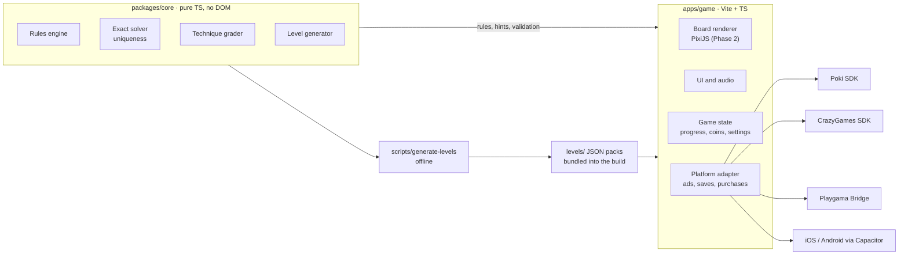

# Architecture

One codebase: a pure TypeScript core, one Vite game app, and one adapter per
platform. Switching from a web portal to iOS means writing a new adapter, not
touching game code.

The core feeds both the offline level script and the game itself, so hints and
validation always match how levels were built. Everything below the adapter
line is swappable.

## packages/core

| Module | Role |
| --- | --- |
| `types.ts` | The on-disk `Level` format (see `docs/references/rules.md`) |
| `level.ts` | `parseLevel` (untrusted JSON → `Level`, all problems reported at once) and `validateLevel` |
| `board.ts` | `buildBoard`: compiles a `Level` into a `Board` with precomputed rays (what each tile sees) and bush neighborhoods |
| `rules.ts` | `evaluate`: lit tiles, conflicts, bush states, solved. `canPlace` (refuses lanterns and locked hint cells) |
| `solver.ts` | `solve` / `isUnique`: exact search with propagation, stops at a solution limit |
| `transform.ts` | The 8 rotations/mirrors, so one stored orientation serves portrait and landscape; `canonicalKey` spots disguised duplicates |
| `grader.ts` | Human-style technique solver: one deduction at a time, simplest first, records the trace (tier, width, reason); can start from a position |
| `hints.ts` | `hint`: removes a wrong firefly or places the grader's next one from the player's position, with a one-line reason; `hintStep` maps a hint to the full trace for analytics |
| `difficulty.ts` | Features, score, tier and estimated solve time from a trace; all weights in `DIFFICULTY_CONFIG` |
| `rng.ts` | Seeded PRNG so every generated level can be regenerated from its spec |
| `shapes.ts` | Garden masks: rectangle, ring, L, bridge, crescent |
| `generator.ts` | Spec → unique, graded level (scatter, hidden answer, derive clues, repair, clue removal, grade) |
| `ramp.ts` | Picks levels for each chapter, orders them as a sawtooth, swaps in a teaching level where each new tier first appears, and places that debut early in the chapter with practice alternating with easier levels |
| `policy.ts` | Next-level policy: main path by default, one detour (warm-up after a break; breather after a quit, a long solve or repeated hints) from a reserve pool, never two in a row |
| `events.ts` | Analytics event schema and `validateEvent`; what Phase 2 logs and Phase 4 refits from (`docs/references/analytics.md`) |
| `players.ts` | Simulated players (four kinds of portal player) walking grader traces with skill, learning, patience, hints and churn; the shipped hint economy (`PLAYER_CONFIG`) |

Rules of the package: no DOM, no Node APIs, no dependencies, relative imports
only (enforced by `tests/ratchets.test.ts` and its tsconfig). Everything is
deterministic so the generator can be seeded.

### How the exact solver works

State per path cell is undecided / firefly / empty. Placing a firefly lights
its row and column and marks every cell it sees as empty (two fireflies may
not see each other). Propagation repeats until stable:

- a numbered bush with all its fireflies → its other neighbors are empty
- a bush that needs every open neighbor → fill them
- a dark tile with exactly one cell left that could light it → place there

Then it branches on the dark tile with the fewest candidates. Branch *k* means
"candidate *k* is the first in order to hold a firefly", so branches are
disjoint and the solution count is exact. Correctness is cross-checked against
a naive enumerator on 300 random boards with every twist
(`packages/core/test/solver.test.ts`).

## apps/game

Plain DOM for the screens, PixiJS for the board, one controller between them.
The look follows the Phase 2 design baseline (`docs/design/phase-2/`).

| Folder | Holds | May import |
| --- | --- | --- |
| `src/state/` | Level catalog (`catalog.ts`), one play with undo, reset, hints and active time (`play.ts`), coins and hint bank (`wallet.ts`), progress and the next-level policy (`session.ts`), status-card wording (`status.ts`) | `@firefly/core` only, no browser globals (ratchet) |
| `src/view/` | Pure layout math: bands, board fit, orientation (`layout.ts`); the PixiJS board (`board.ts`); CSS tokens read into a Pixi palette (`theme.ts`) | `state/`, `pixi.js` |
| `src/ui/` | The play screen's DOM (`screen.ts`, `game.css`) and the controller (`app.ts`) | `state/`, `view/`, `platform/` |
| `src/platform/` | The `Platform` interface and adapters; the only door to SDKs (ratchet) | |

- **Layout follows the screen's shape** (`bandFor`): tall (phones in portrait), square
  (iPhone Duo, tablets), wide (landscape, desktop). The board picks its rotation when a level
  starts and keeps it through a resize or fold unless cells would drop under 44 px.
- **The board draws, the state decides.** `BoardView.render` takes a `BoardState` (evaluation,
  locked cells, hint outlines) and reports taps as canonical cell indices, so rotation never
  reaches game state, saves or events.
- **Colors live only in `src/theme.css`.** The board reads them through `readPalette`; a
  ratchet rejects color literals anywhere else in `apps/game/src`.
- `src/platform/local.ts`: development adapter (no ads, localStorage saves).
- **Hosting (playtest):** Vercel builds from the repo root (`vercel.json`: `npm ci`, `npm run build`,
  output `apps/game/dist`), production from `develop`, a preview per pull request. Headers: a
  strict content security policy (no eval, no outside origins; Pixi runs through
  `pixi.js/unsafe-eval`, its eval-free path), no indexing, long cache for hashed assets.

## Data flow (target)

1. `scripts/generate-levels.ts` runs the launch plan (`scripts/launch-plan.ts`): it builds,
   grades and orders each chapter into `levels/launch.json`, fills `levels/reserve.json`, and
   writes the report tables to `reports/`.
2. CI re-validates every pack with the exact solver.
3. The game bundles the packs, rotates each level to fit the screen, and uses `evaluate` for play and `hint` (the grader from the current position) for hints.
4. Progress goes through `Platform.save/load` and is validated on the way back in.
